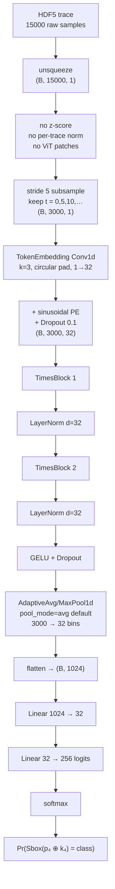
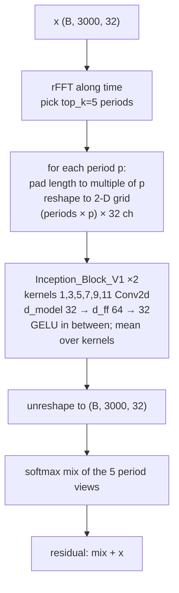

# T-004: TimesNet original (non-Scoop)

## Status

`paused` — catalog is complete for cited runs; remaining items are optional GPU runs (ask first) (2026-10-04 cleanup)

## Goal

Catalog **every TimesNet run that does not use the Scoop optimizer**: architecture, dataset, labels, and attack metrics. Identify which recipes recover keys. Scoop-on-TimesNet lives in **[T-011](./T011-timesnet-scoop-blackbox.md)**.

## Context

Package: `TimesNet/` (`model.py`, `config.py`, layers, README). Train/test hooks in `ASCAD_train_models.py` / `ASCAD_test_models.py` / `benchmark_full_fixedkey_gpu.py`. Commit landmark: `d3a848d`.

Shared backbone defaults unless noted: `d_model=32`, `d_ff=64`, `e_layers=2`, `top_k=5`, `num_kernels=6`, `dropout=0.1`, RAdam, LR **1e-4**. Random 256-way CE ≈ **ln(256) ≈ 5.545**.

### Model variants (code)

| Code name | Class | Head | Typical input | Params (order) |
|-----------|--------|------|---------------|----------------|
| `timesnet` | `BaseTimesNetClassifier` | flatten \(L\times d\) → 256 | ATMEGA `(B,700,1)` | ~8.1M |
| `timesnet_ascad_head` | `TimesNetASCADHead` | flatten → `1024→1024→256`; emb kernel **11** | same | ~26.6M |
| `timesnet_multi` | `TimesNetMultiTask` | pool → 18 heads (α, β, 16× sbox); no permind | v2 `(B,15000,1)` stride 5, pool 32 | ~2.5M |
| `timesnet_ascad_head_multi` | `TimesNetASCADHeadMulti` | same + dense trunk; emb kernel **11** | same | ~8.2M |
| `timesnet_pooled` / `pooled` | **`TimesNetPooledClassifier`** | stride+pool → **one** Linear → 256 | v2 L=15k, stride 5, pool 32 | **2.39M** |
| `timesnet_ascad_head_pooled` | `TimesNetASCADHeadPooled` | pool + dense trunk | available, **not trained** | — |

**Do not mix:** flatten-head v1 models vs pooled v2 models; multilabel α/β vs black-box `Sbox(p⊕k)`; `rank_final` @ 1k vs Scoop **GE** @ 300k.

---

## Byte-4 working model — structure

The only ASCADv2 TimesNet that moved GE into single digits is **`TimesNetPooledClassifier`** (`pooled`), byte **4**, black-box `Sbox(p₄ ⊕ k₄)`. Same graph for RAdam (this file) and Scoop ([T-011](./T011-timesnet-scoop-blackbox.md)); only the optimizer changes.

**Not** `timesnet_ascad_head`. **Not** `timesnet_multi`. **No ViT patches.** **No z-score / per-trace normalization in the runner** — HDF5 samples go in as raw `float32`.

One-line path:

```text
raw trace (15000)
  → unsqueeze channel (B, 15000, 1)
  → [no z-score, no sample LayerNorm, no patches]
  → stride-5 subsample (keep every 5th sample) → (B, 3000, 1)
  → Conv1d token embed k=3, circular pad, 1→32  +  sinusoidal position
  → Dropout
  → TimesBlock × 2  (FFT top-5 periods → fold to 2-D → Inception 2-D → residual)
      each followed by LayerNorm
  → GELU + Dropout
  → adaptive avg-pool to 32 time bins (or max if pool_mode=max) → flatten 32×32=1024
  → Linear 1024→32
  → Linear 32→256 logits
  → softmax → Pr( Sbox(p₄ ⊕ k₄) = c )   c ∈ {0…255}
```



Inside each **TimesBlock** (input = output = `(B, 3000, 32)`; residual add at the end):



| Stage | What it is | What it is not |
|-------|------------|----------------|
| Stride 5 | Keep every 5th sample (cheap length cut 15k→3k) | Not a learned patch embed; no overlap/window |
| Conv1d k=3 | Local token mix, 1 channel → 32 | Not a 16/32-sample patch tokenizer |
| TimesBlock 2-D fold | Period-based reshape so 2-D conv sees intra- and inter-period | Not spectrogram STFT; periods chosen per batch via FFT energy |
| Pool 32 | Adaptive **avg** (default) or **max** (`pool_mode`) over time into 32 bins, then linear to 32-d | Not flatten-`L×d`; not a learned param — must **retrain** to compare |
| Head | One linear 32→256 | Not the dense `1024→1024→256` ASCAD head |
| Output | 256-way **unmasked S-box** of **byte 4** | Not the AES key byte; not α/β/masked shares |

Code: `TimesNet/model.py` → `TimesNetPooledClassifier`; embed `TimesNet/layers/Embed.py`; Inception `TimesNet/layers/Conv_Blocks.py`; runner `Scoop/experiments/ascadv2_repro/run_timesnet_blackbox.py` (raw traces, `.unsqueeze(-1)`).

Attack-time (not in the net): logits → log-softmax over S-box classes; for each key hypothesis `h` use class `Sbox(p₄ ⊕ h)` and accumulate. GE is mean rank of the true key.

---

## Comprehensive catalog (non-Scoop)

### A. ASCADv1 — ATMEGA AES fixed-key (single-label S-box byte 2)

| Item | Value |
|------|--------|
| Dataset | `ATMEGA_AES_v1/.../ASCAD{,_desync50,_desync100}.h5` |
| Trace | 700 samples; profiling 50k / attack 10k |
| Labels | 256-way `Sbox(p⊕k)` on **byte 2** (fixed key) |
| Optimizer | RAdam (TimesNet train path) |
| Metrics | `rank_final`, `traces_to_rank0` @ 10k attack traces; later `ge_final` |

#### A1. Best folder — `benchmark_runs/` (profile LR 1e-4, **150 epochs**, seeds 0–1)

JSON: `ATMEGA_AES_v1/ATM_AES_v1_fixed_key/ASCAD_data/ASCAD_trained_models/benchmark_runs/`

Mean over seeds:

| Model | Desync | rank_final mean | ttr0 mean | train CE | ge_final mean |
|-------|--------|-----------------|-----------|----------|---------------|
| `timesnet` | 0 | 42.5 | null | 0.42 | 43 |
| `timesnet` | 50 | 19.5 | null | 0.48 | 18.5 |
| `timesnet` | 100 | 179.5 | null | 0.36 | 178.5 |
| **`timesnet_ascad_head`** | **0** | **0** | **~165** | ~5.21 | **0** |
| `timesnet_ascad_head` | 50 | 2.0 | ~5340 | ~1.65 | 2.0 |
| `timesnet_ascad_head` | 100 | 1.5 | ~5795 | ~0.72 | 1.5 |

Per-seed `timesnet_ascad_head` @ 150e:

| Desync | seed 0 rank / ttr0 | seed 1 rank / ttr0 |
|--------|--------------------|--------------------|
| 0 | 0 / 180 | 0 / 150 |
| 50 | 3 / 5930 | 1 / 4750 |
| 100 | 3 / 9230 | 0 / 2360 |

**Headline:** ASCAD-head TimesNet **recovers the key** on v1 desync0 (~150–180 traces to rank 0) even though CE stays near random. Vanilla flatten TimesNet **overfits labels** (CE ≪ 1) with poor rank, especially desync100.

Complexity vs `cnn_best` (same defaults, seq_len=700): CNN ~66.7M params / ~0.41G MACs; TimesNet ~8.1–26.6M params / **~8.2G MACs**.

#### A2. `timesnet_lr1e-4/` — same LR, **75 epochs** only

| Model | Desync | rank mean | ttr0 | Note |
|-------|--------|-----------|------|------|
| `timesnet` | 0 | 22 | null | CE ~4.9 |
| `timesnet_ascad_head` | 0 | 1.5 | ~3230 (high seed var) | not yet the 150e recipe |
| `timesnet_ascad_head` | 50 / 100 | 87 / 103.5 | null | 75e not enough |

#### A3. `timesnet_lr1e-3/` — messy; do not treat as a fair table

Incomplete eval-only / missing ckpts. Head on desync0 is **dead** (rank ~243). Vanilla desync0 mixed (one seed rank 0 @ 3720 traces). **Do not cite as primary.**

#### A4. `timesnet_lr1e-2/` — seed 0, 75e — avoid for ASCAD-head

| Model | Desync | rank | CE | Read |
|-------|--------|------|-----|------|
| `timesnet` | 0 | 12 (ttr0=590) | 4.57 | weak |
| `timesnet` | 100 | **234** | **0.14** | classic label overfit |
| `timesnet_ascad_head` | all | ~232–234 | 5.544 | never learned |

**Best practical v1 recipe:** `timesnet_ascad_head`, LR **1e-4**, **150 epochs**. Avoid LR=1e-2 for the ASCAD head.

---

### B. ASCADv2 — multilabel gray-box (T-009; still RAdam, not Scoop)

| Item | Value |
|------|--------|
| Dataset | `STM32_AES_v2/.../ascadv2-extracted.h5` (15 000 samples; affine mask + shuffle) |
| Labels | α (`masks[18]`), β (`masks[17]`), 16× **masked** sbox; `multilabel=2`, **no permind** |
| Attack | recombine Pr(α), Pr(β), Pr(masked S) → Pr(unmasked S) → key rank; `simulated_key=1` |
| Train | first **100k** Profiling; batch 64; stride **5**; pool_segments **32** |
| Eval | `Attack_traces`, **1000** traces, `rank_step=10` |
| Metric | per-byte `rank_final` (random ≈ 128); mean over 16 bytes |
| Optimizer | RAdam 1e-4 + AMP |

Runs (same two architectures):

| Run | Epochs | Train CE (multi / head) | Mean rank multi / head | Outcome |
|-----|--------|-------------------------|------------------------|---------|
| first (`*_t100k_e22`) | 22, early stop | barely &lt; 5.54 | **141.1 / 133.2** | fail |
| s5p32 e30 | 30 fixed | 5.46 / 5.45 | **129.6 / 126.4** | fail |
| **s5p32 e60** (final) | 60 | **5.29 / 5.30** | **124.3 / 137.2** | fail (watcher: no e90) |

**e60 per-byte `rank_final`** (`summary_full_fixedkey_gpu.json`, ckpt `*_s5p32_t100k_e60.pth`):

`timesnet_multi` (mean 124.3; min 7 max 246):

| 0 | 1 | 2 | 3 | 4 | 5 | 6 | 7 | 8 | 9 | 10 | 11 | 12 | 13 | 14 | 15 |
|---|---|---|---|---|---|---|---|---|---|----|----|----|----|----|-----|
| 36 | 42 | 76 | 246 | 141 | 115 | 241 | 145 | 236 | **7** | 44 | 154 | 74 | 237 | 31 | 163 |

`timesnet_ascad_head_multi` (mean 137.2; min 12 max 253): 221, 135, 253, 31, 247, 99, 227, 20, 96, 122, 234, 13, 12, 12, 225, 248.

Sanity: alpha-only overfit 512 traces × 30e → CE 5.57→5.21 (can move CE; not a full attack).

**Verdict:** multilabel TimesNet on v2 **did not** produce a usable key recovery at 1k attack traces. A few lucky low ranks (e.g. byte 9 rank 7) are not a 16-byte story. This is a **different attack model** from Scoop (masks are training labels).

Ckpts: `STM32_AES_v2/ASCAD_data/ASCAD_trained_models/timesnet_*_noperm_s5p32_t100k_e{30,60}.pth`. Logs: `logs/t009_timesnet_v2/`. Detail: [T-009](./T009-stm32-key-recovery.md).

---

### C. ASCADv2 — black-box single-label, RAdam (Scoop *protocol*, not Scoop *optimizer*)

This is the run that **did something** on v2. Full narrative: `Scoop/artifacts/timesnet_blackbox/REPORT_phase1.md` + `phase_1_faq.md`. Sweep: `…/byte_sweep/PHASE15_BYTE_SWEEP_REPORT_latest.md`.

| Item | Value |
|------|--------|
| **Model (exact)** | **`TimesNetPooledClassifier`**, variant `pooled` |
| Encoder | 2× TimesBlock, `d_model=32`, `d_ff=64`, `top_k=5`, emb kernel **3** |
| Length | raw **15 000** → `input_stride=5` → L_eff=**3000** → `pool_segments=32` → Linear(1024→32) → **Linear(32→256)** |
| Params | **2 385 472** |
| Labels | unmasked **`Sbox(p_b ⊕ k_b)`** — **no** α/β/permind |
| Split | Profiling **200k** train / Attack **1k** val / Profiling **[200k:500k]** GE (300k); Scoop zero-trace fix at 99999, 199999, 299999 |
| Opt | **RAdam** 1e-4, batch 32, 25 epochs, AMP on, grad clip 1.0 |
| Metric | Scoop GE, `n_tries=20`, step 10k, budget 300k |
| Hardware | RTX 5090; ~1.3 GB CUDA; ~46 GB RSS; ~4.5–5 h / byte |

`ascad_head_pooled` was **not** trained.

#### Byte 4 (Phase 1 full) — the positive result

Run `timesnet_pooled_b04_seed0_full`. Best-val ckpt = epoch **10** (later epochs 16–25 **NaN** under AMP; GE from restored best weights).

| Metric | Value |
|--------|--------|
| `best_ge` | **2.9 @ 190 001** traces |
| `ge_last` | **3.65 @ 290 001** |
| `traces_to_ge0` | **null** (never 0) |
| Train CE | stuck ~5.545 then NaN |

Selected GE: 1→122.7; 50k→69.3; 100k→30.4; 150k→11.0; 190k→**2.9**; 250k→7.4; 290k→3.65.

Same ckpt under **rank_final** (not GE): Attack[:1000] rank **102** (no ttr0); Scoop slice first 1k rank **17** (no ttr0). Small-budget rank is **not** a success; large-budget GE is.

Vs local Scoop **finetune MLP** on same byte/split (metric-fixed t20): MLP `ge_last≈7.7`. Pooled TimesNet+RAdam **beats** that MLP on this seed/byte, with **2.39M** vs a much larger MLP, and **without** Scoop.

#### Bytes 0–3 (Phase 1.5) — unsuccessful

Same settings; seed 0; no GE→0.

| Byte | ge_last | best_ge | Status |
|------|---------|---------|--------|
| 0 | 190.6 | 114.0 @ 10k | fail |
| 1 | 111.5 | 90.5 @ 50k | fail |
| 2 | 123.0 | 104.0 @ 230k | fail |
| 3 | 116.6 | 76.0 | fail |
| **4** | **3.65** | **2.9 @ 190k** | **only useful row** |
| 5–15 | — | — | **not run** |

---

## Did TimesNet “achieve something” on ASCADv2?

**Yes, one narrow black-box result — not the multilabel path.**

| Claim | True? | Exact model | What happened |
|-------|-------|-------------|---------------|
| Multilabel TimesNet recovers v2 keys @ 1k traces | **No** | `timesnet_multi` / `timesnet_ascad_head_multi` | mean rank ~124–137 ≈ random |
| Black-box TimesNet recovers **all** bytes | **No** | `TimesNetPooledClassifier` | bytes 0–3 GE ~76–191 |
| Black-box TimesNet on **byte 4** drives GE to single digits @ ~200k traces | **Yes** | **`TimesNetPooledClassifier` (`pooled`), stride=5, pool=32, 2.39M, RAdam, Sbox(p⊕k), 200k/25e/seed 0** | best GE **2.9**, last **3.65**; **not** GE=0 |
| Paper target GE=0 by 250k/300k | **No** | same | never hit 0 |
| That result used Scoop | **No** | RAdam | Scoop comparison is T-011 (byte 4 GE last **2.75**, still not 0) |

Read it as: **weak, byte-specific leakage** that only shows up after a huge attack budget, with almost-flat softmax (CE stuck at random). Not a 16-byte key recovery and not a Scoop-optimizer win.

---

## Plan

- [x] Port TimesNet for ASCAD lengths; baseline + ASCAD-head
- [x] Integrate train / test / `benchmark_full_fixedkey_gpu.py`
- [x] Multi-desync multi-seed v1 jobs
- [x] LR / epoch analysis (with T-005)
- [x] Complexity vs `cnn_best`
- [x] v2 multilabel TimesNet (executed under T-009; catalogued here)
- [x] v2 black-box pooled + RAdam bytes 0–4 (executed under T-011 Phase 1/1.5; catalogued here)
- [ ] Improve v1 desync100 for **vanilla** TimesNet without label overfit
- [ ] Fair apples-to-apples sweeps (fixed epochs/batch/seeds) for publication tables
- [ ] Optional: `ascad_head_pooled` black-box; bytes 5–15; AMP-off retrain of byte 4 (NaN after e15)
- [ ] Optional: byte-4 pooled **max**-pool retrain (`--pool-mode max`) vs avg baseline — **ask first**

## Decisions

- Keep TimesNet under `TimesNet/`; do not mutate HDF5.
- Prefer **key rank / GE**, not CE alone (head can attack well with CE near random).
- **Best v1 recipe:** `timesnet_ascad_head`, LR=1e-4, 150 epochs. Avoid LR=1e-2 for that head.
- CNN is param-heavy / compute-light; TimesNet is param-light / compute-heavy (~20× MACs vs cnn_best at default sizes).
- Flatten `L×d` heads are research-broken at v2 L=15k; v2 uses **stride + segment pool**.
- 2026-08-13: Non-Scoop TimesNet (including v2 black-box RAdam) is reported **here**. TimesNet+**Scoop** is **T-011** only.
- 2026-09-23: File renamed `T004-timesnet-models.md` → `T004-timesnet-original.md`. Byte-4 pooled structure documented as a flowchart (no patches, no z-score).

## Working notes / session log

### 2026-09-23 — max vs avg 5-epoch smoke (bytes 0–4, RAdam not Scoop)

Matched recipe: 2000/200/2000, 5e, RAdam, pooled. **No Scoop.**

| Byte | avg CE last | max CE last | avg ge_last | max ge_last |
|------|-------------|-------------|-------------|-------------|
| 0 | 5.542 | 5.548 | 3.6 | 10.0 |
| 1 | 5.544 | 5.550 | 222.0 | 166.8 |
| 2 | 5.547 | 5.551 | 220.4 | 100.6 |
| 3 | 5.548 | 5.552 | 195.4 | 180.2 |
| 4 | 5.548 | 5.551 | 172.6 | 139.6 |

Verdict at this budget: **about the same** — CE stays random; GE @ 2000/5 tries is noise. Byte 0 low GE happens for **avg too** (even lower), so it is the tiny attack slice, not max-pool. Do not compare these to full avg Phase 1.5 (200k/25e).

### 2026-09-23 — max-pool 5-epoch smoke (bytes 0–3)

- Same recipe as byte-4 smoke: 2000/200/2000, 5e, RAdam, `pool_mode=max`. All four **exit 0**, finite CE, ~44 s / byte.
- Train CE always settles ~5.55 (random). GE @ 2000 traces / 5 tries is **noisy**, not an attack claim. Byte 0 `ge_last=10` matches the earlier avg pathcheck smoke oddity on a tiny slice — do not treat as recovery.

| Byte | Train CE last | Best val | ge_last | best_ge |
|------|---------------|----------|---------|---------|
| 0 | 5.548 | 5.547 | 10.0 | 10.0 |
| 1 | 5.550 | 5.569 | 166.8 | 86.4 |
| 2 | 5.551 | 5.552 | 100.6 | 98.4 |
| 3 | 5.552 | 5.543 | 180.2 | 117.6 |
| 4 (prior) | 5.551 | 5.561 | 139.6 | 89.0 |

### 2026-09-23 — max-pool 5-epoch smoke (byte 4)

- Ran `timesnet_pooled_b04_seed0_maxpool_e5_smoke`: `--pool-mode max`, 2000/200/2000 traces, 5e, RAdam, no `--smoke` flag (that flag caps epochs at 2).
- **Works:** exit 0, finite CE, GE completed. Train 5.688→5.551 / val ~5.56 (random ≈5.545). `ge_last=139.6`, `best_ge=89` @ 2000 traces — not an attack claim.
- Wall **43.7 s**, peak CUDA **1.09 GB**. Same param count 2.39M.
- Summary: `Scoop/artifacts/timesnet_blackbox/metrics/timesnet_pooled_b04_seed0_maxpool_e5_smoke_summary.json`

### 2026-09-23 — avg/max temporal pool switch

- `TimesNetConfig.pool_mode`: `"avg"` (default) or `"max"`. Shared `temporal_pool()` in `TimesNet/model.py`. Black-box CLI: `--pool-mode max`.
- Default stays avg so Phase 1/2 checkpoints still match. Max is not a free eval-time swap of a trained avg model.
- Smoke: dummy `(2,15000,1)` forward both modes → `(2,256)`; peaked-bin unit check avg 1.25 vs max 5.

### 2026-09-23 — rename + byte-4 flowchart

- File slug is now `T004-timesnet-original.md`.
- Added end-to-end structure for the byte-4 pooled model (raw trace → stride → Conv1d embed → TimesBlocks → pool → S-box logits). Confirmed in code: runner does **not** z-score; **not** patchify.

### 2026-08-13 — comprehensive non-Scoop catalog

- Summary: Folded v1 benchmarks, T-009 multilabel, and T-011 Phase 1/1.5 RAdam black-box into this file. Scoop-on-TimesNet stays in T-011.
- Metrics / results: see catalog above. Only v2 success is pooled TimesNet+RAdam on **byte 4** (GE 2.9 / 3.65).

### 2026-07-15 — complexity (session `019f64f3-b502…`, `grok-4.5`)

Measured defaults (`d_model=32`, `d_ff=64`, `e_layers=2`, `top_k=5`, `num_kernels=6`, `seq_len=700`):

| | cnn_best | timesnet | timesnet_ascad_head |
|--|----------|----------|---------------------|
| Params | ~66.7M | ~8.1M | ~26.6M |
| Approx MACs / sample | ~0.41G | ~8.2G | ~8.2G |

### 2026-07-15 — fixed-key summary folders (same session; detail in T-005)

| Folder | Role |
|--------|------|
| `benchmark_runs/` | Best TimesNet results; 150 epochs; seeds 0–1 |
| `timesnet_lr1e-2/` (alias `benchmark_runs_lr1e-2/`) | High LR stress; head mostly dead |
| `timesnet_lr1e-3/` | Incomplete / messy — treat carefully |
| `timesnet_lr1e-4/` | 75-epoch TimesNet |

Training cost: TimesNet often ~40–75+ min / setting even at batch 1024–2048 (MAC-heavy).

## Next actions

| Action | I | U | S | Notes |
|--------|---|---|---|-------|
| Treat `timesnet_ascad_head @ 1e-4 / 150e` as v1 baseline | H | M | H | done as default |
| Optional AMP-off retrain of v2 pooled byte 4 (NaN e16–25) | M | L | M | cleaner CE trajectory; GE already valid from e10 ckpt |
| Bytes 5–15 black-box RAdam | M | L | L | 4.5–5 h each; ask first |
| Byte-4 `pool_mode=max` retrain vs avg | M | L | M | same I/O; ask before GPU; `--pool-mode max` |
| Fair v1 table vs CNN/MLP (T-006) | H | L | L | |
| Vanilla TimesNet desync100 without label overfit | M | L | L | |

### Priority snapshot

- **Do now:** use this catalog when citing TimesNet (not T-011 unless optimizer is Scoop)
- **Before next meeting:** v2 story = **pooled TimesNet + RAdam, byte 4, GE≈3**, not multilabel
- **Deep work (park):** more bytes / head-pooled / v1 desync100

## Related

- Scoop-on-TimesNet: [T-011](./T011-timesnet-scoop-blackbox.md)
- v2 multilabel campaign log: [T-009](./T009-stm32-key-recovery.md)
- Metrics: [T-005](./T005-sca-metrics-and-results.md), `docs/notes/metrics.md`
- CNN/MLP: [T-006](./T006-cnn-mlp-baselines.md)
- Paths: `TimesNet/`, `benchmark_full_fixedkey_gpu.py`, `STM32_AES_v2/ASCAD_data/ASCAD_trained_models/`, `Scoop/artifacts/timesnet_blackbox/` (RAdam runs only)
- Sessions: `019f64f3-b502-7e52-8915-54d3fca95536`
